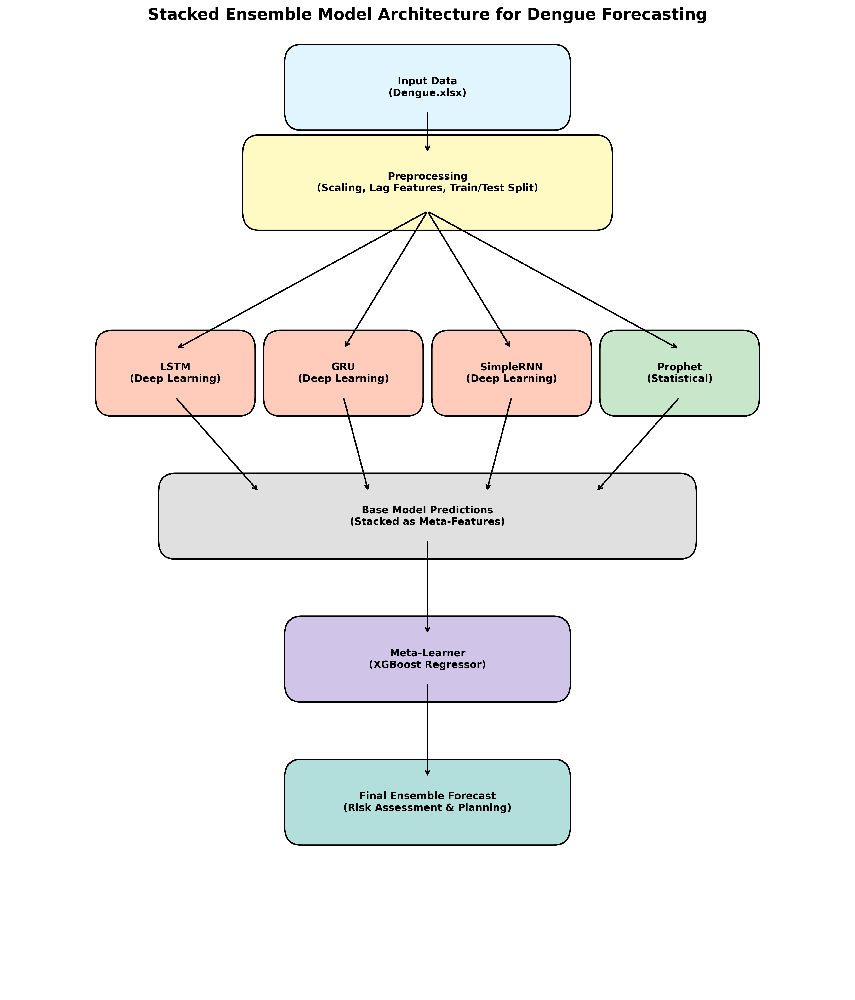

# Dengue Case Prediction and Analysis

An experimental machine learning project focused on dengue case analysis, time-series forecasting, spatial exploration, and blood reserve planning using historical dengue data from Bangladesh.

## Project Overview

This project explores historical dengue cases in Bangladesh using machine learning, deep learning, statistical forecasting, and ensemble learning techniques.

It combines multiple forecasting models to investigate historical dengue trends and estimate future case patterns. The project also includes regional spatial analysis, experimental dengue risk classification, and a blood reserve planning framework.

## Project Objectives

- Analyze historical dengue case trends in Bangladesh.
- Forecast future dengue cases using machine learning and deep learning models.
- Compare different forecasting approaches.
- Explore regional dengue case distributions across eight divisions.
- Investigate spatial patterns using clustering and spatial autocorrelation techniques.
- Perform experimental dengue risk classification.
- Estimate potential blood reserve requirements through an experimental planning framework.

## Dataset

The project uses historical dengue data from Bangladesh.

**Dataset Information:**

- **File Name:** `Dengue.xlsx`
- **Total Records:** 51
- **Total Features:** 20
- **Data Coverage:** September 2019 – October 2025
- **Geographic Coverage:** Eight divisions of Bangladesh.

The dataset contains monthly dengue case and death records, including division-wise affected cases and deaths.

### Dataset Source and Usage Permission

- **Dataset Source:** Original source URL is not available in the current project documentation.
- **Public Distribution Permission:** Confirmed.
- **Dataset File:** `Dengue.xlsx`

The dataset is included in this repository with confirmed permission for public distribution.

## Methodology

The project follows multiple analytical and modeling approaches.

### 1. Data Preprocessing

- Data loading and inspection using Pandas.
- Data cleaning and preparation.
- Date generation using year and month information.
- Chronological sorting.
- Forward filling of missing cell values.
- Min-Max feature scaling.
- Time-series sequence preparation using a three-record look-back window.
- Chronological training, validation, and testing split.

The Python pipeline uses a 70% training set, 15% validation set, and 15% testing set.

### 2. Time-Series Forecasting

The following models are implemented for dengue case forecasting:

- **LSTM (Long Short-Term Memory):** A recurrent neural network architecture for learning sequential patterns.
- **GRU (Gated Recurrent Unit):** A recurrent architecture for sequence modeling.
- **SimpleRNN:** A basic recurrent neural network for time-series analysis.
- **Prophet:** A statistical forecasting model for analyzing temporal trends.

### 3. Stacked Ensemble Learning

An XGBoost Regressor is used as the meta-learner in a stacking ensemble approach.

The ensemble combines predictions from the base forecasting models, along with a month-based feature, to generate final predictions.

TimeSeriesSplit cross-validation is used during meta-feature generation.

### 4. Experimental Dengue Risk Classification

The project includes a threshold-based approach for categorizing dengue risk levels.

- High-risk threshold: 75th percentile of historical affected cases.
- Medium-risk threshold: 50th percentile of historical affected cases.
- Future risk categories are estimated using ensemble predictions.

### 5. Spatial Analysis

The project explores regional spatial patterns using:

- **DBSCAN:** Density-based clustering using approximate geographic coordinates of the eight divisions.
- **Moran's I:** Spatial autocorrelation analysis using inverse-distance spatial weights.

The analysis also visualizes regional case distribution using geographic coordinates and case totals.

### 6. Future Forecasting

The forecasting pipeline generates experimental predictions for the next six months.

- RNN predictions are used for the experimental blood reserve planning calculations.
- Ensemble predictions are used for future dengue risk classification.

### 7. Blood Reserve Planning

An experimental framework estimates potential national blood reserve requirements and regional allocation.

The implementation uses predefined assumptions:

- Severity rate: 20%.
- Estimated blood bags per patient: 2.
- Safety buffer: 50 bags.
- Additional 10% allocation adjustment for locations identified by the DBSCAN clustering process.

These assumptions are experimental and are not validated medical guidelines.

## Model Architecture

The following flowchart illustrates the stacked ensemble forecasting architecture implemented in the project.



**Architecture Workflow:**

1. Input historical dengue data.
2. Preprocess and prepare time-series data.
3. Generate predictions using LSTM, GRU, SimpleRNN, and Prophet.
4. Combine base model predictions as meta-features.
5. Apply XGBoost as the meta-learner.
6. Generate final ensemble forecasts for experimental risk assessment and planning.

## Model Evaluation

The project evaluates forecasting and classification performance using the following metrics.

**Regression Metrics:**

- Root Mean Squared Error (RMSE)
- Mean Absolute Error (MAE)
- Weighted Mean Absolute Percentage Error (WMAPE)

**Classification Metrics:**

- Accuracy
- Macro Precision
- Macro Recall
- Macro F1-Score
- Micro Precision
- Micro Recall
- Micro F1-Score
- Matthews Correlation Coefficient (MCC)
- Area Under the ROC Curve (ROC-AUC)

Model performance should be interpreted in the context of the small dataset and its temporal limitations.

## Technologies Used

**Programming Language**
- Python

**Data Analysis and Processing**
- Pandas
- NumPy
- OpenPyXL

**Data Visualization**
- Matplotlib
- Seaborn

**Machine Learning and Deep Learning**
- Scikit-learn
- TensorFlow / Keras
- XGBoost
- Prophet

**Development Environment**
- Jupyter Notebook

## Project Structure

```text
Dengue-Case-Prediction-Analysis/
│
├── Dengue.xlsx
├── dengue_analysis.ipynb
├── dengue_analysis.py
├── model_flowchart.py
├── model_architecture_flowchart.png
├── requirements.txt
├── README.md
├── .gitignore
└── .gitattributes
```

**File Descriptions:**

- `Dengue.xlsx` – Historical dengue dataset.
- `dengue_analysis.ipynb` – Jupyter Notebook implementation and analysis.
- `dengue_analysis.py` – Python-based analysis and forecasting pipeline.
- `model_flowchart.py` – Script for generating the model architecture flowchart.
- `model_architecture_flowchart.png` – Generated model architecture visualization.
- `requirements.txt` – Required Python libraries.
- `README.md` – Project documentation.
- `.gitignore` – Specifies files excluded from Git tracking.
- `.gitattributes` – Git file-handling configuration.

## Installation and Setup

### 1. Clone the Repository

```bash
git clone https://github.com/Sameer372/Dengue-Case-Prediction-Analysis.git
```

### 2. Navigate to the Project Directory

```bash
cd Dengue-Case-Prediction-Analysis
```

### 3. Create a Virtual Environment (Optional)

```bash
python -m venv .venv
```

Activate the environment on Windows:

```bash
.venv\Scripts\activate
```

### 4. Install Dependencies

```bash
pip install -r requirements.txt
```

For Jupyter Notebook execution, install Notebook if it is not already available:

```bash
pip install notebook
```

## How to Run

### Run the Python Analysis Pipeline

```bash
python dengue_analysis.py
```

### Open the Jupyter Notebook

```bash
jupyter notebook dengue_analysis.ipynb
```

Alternatively, open the notebook using JupyterLab or Visual Studio Code.

### Generate the Model Architecture Flowchart

```bash
python model_flowchart.py
```

This generates:

```text
model_architecture_flowchart.png
```

The generated image should be placed in the repository root directory alongside `README.md`.

## Generated Outputs

Running the Python pipeline generates analytical outputs and visualizations, including:

- Historical dengue case trends.
- Actual versus predicted case comparisons.
- ROC curve comparisons.
- Confusion matrix visualization.
- Spatial clustering visualization.
- Six-month future forecasts.
- Estimated national blood demand.
- Regional blood allocation charts.
- Predicted regional dengue cases.

The execution summary is saved locally as `summary.txt`.

## Limitations

- The dataset contains 51 records across September 2019 to October 2025, with 23 consecutive missing calendar months from February 2020 to December 2021.
- The current preprocessing pipeline does not insert rows for missing calendar months. Consequently, adjacent records in the sequence may not represent adjacent months.
- The relatively small dataset limits the amount of historical information available for model training.
- The Jupyter Notebook and Python script contain implementation differences and may produce different results.
- Forecasting results require further validation using appropriate chronological evaluation methods.
- DBSCAN clustering uses approximate geographic coordinates rather than dengue case counts as clustering inputs. Therefore, its clusters should not be interpreted as confirmed epidemiological hotspots.
- Moran's I results are exploratory and require further statistical validation.
- Blood reserve estimates rely on predefined experimental assumptions rather than validated medical guidelines.
- The original dataset source URL is not available in the current project documentation, limiting independent source verification.

## Future Improvements

- Improve missing-period handling and time-series data preparation.
- Synchronize the Jupyter Notebook and Python implementations.
- Improve forecasting validation and model reliability.
- Explore additional forecasting and ensemble learning techniques.
- Refine regional spatial analysis and epidemiological hotspot identification.
- Improve dengue risk classification approaches.
- Validate blood reserve estimation assumptions using reliable epidemiological data and expert-reviewed guidelines.
- Document the original dataset source and additional data provenance information.

## Disclaimer

This project is developed for academic and research purposes.

The forecasting outputs, spatial analysis, dengue risk classifications, and blood reserve estimates are experimental. They should not be considered medical advice or used as standalone evidence for clinical, public health, or blood bank operational decisions.

## Author

**Shaikh Sameer**

GitHub: [@Sameer372](https://github.com/Sameer372)

---

If you find this project useful, feel free to explore the repository and its implementation.
